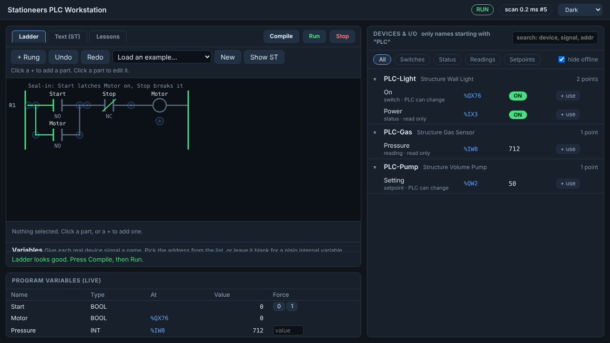

# Stationeers PLC Workstation

Learn real PLC programming inside Stationeers. Write **Ladder Logic** or **Structured Text** in a web page and run it on your base, or connect an outside PLC (OpenPLC, CODESYS, Python) over **Modbus TCP**.


*The workstation page (sample data).*

**Version 0.7.0** · BepInEx 5 plugin · MIT licence · made by Taurwise

> **Status: early release.** It has been tested by the author in single player, installed as a BepInEx plugin. Loading it as a StationeersLaunchPad mod folder (the Steam Workshop route) has not been tested yet. Please report problems with your `BepInEx/LogOutput.log`.

## What it does

- **Built-in PLC.** A Structured Text program runs inside the game every 0.1 s, or draw the same logic as a ladder. Timers (TON), comparisons, set/reset coils.
- **Web workstation.** Opens in your browser at `http://127.0.0.1:15882/` while a save is loaded. Ladder editor with undo/redo, text editor with autocomplete and live error checking, five guided **Lessons**, a live I/O list, **Force** switches for testing, and seven themes (Dark, Light, LCARS, Terminal, Blueprint, Solar, Borg).
- **Modbus TCP bridge.** Every device with a logic interface becomes numbered points (`127.0.0.1:5020`). The mod is the Modbus *slave*; your PLC is the client.
- **Permanent I/O list.** A CSV file records every address and never reuses one, so programs keep working as your base changes. Renamed devices keep their addresses; offline devices can be removed with one button.

## Requirements

- Stationeers (Steam) with **BepInEx 5** installed. If you use mods from the Steam Workshop you most likely already have it through **StationeersLaunchPad**.
- Windows. (The author has only tried it there.)

## Install

1. Download `StationeersPlc-0.7.0.zip` from the [Releases](../../releases) page and unzip it.
2. Close Stationeers completely.
3. Copy the `StationeersPlc` folder (it holds `StationeersPlc.dll`) into `Stationeers\BepInEx\plugins\`.
   The usual Steam location is `C:\Program Files (x86)\Steam\steamapps\common\Stationeers`.
4. Start the game and load a save. After about 30 seconds, open <http://127.0.0.1:15882/>.

To update, close the game and replace the DLL. To remove, delete the `StationeersPlc` folder. Your settings, I/O list and programs stay in `BepInEx\config`.

## Quick start

1. Open the **Lessons** tab and load **Blink** or **Seal-in**.
2. Put your own device's address in the program. Find it in the **Devices & I/O** list (the blue code such as `%QX76`), or press **+ use**.
3. Press **Compile**, then **Run**. Programs always start stopped.
4. Use the **Force** buttons in the variables table to press a button without touching the game.

Example, a blinking light (replace `76` with your device's coil address):

```
PROGRAM Main
VAR
    Light AT %QX76 : BOOL;
    Tick  : TON;
END_VAR

Tick(IN := NOT Tick.Q, PT := T#1s);
IF Tick.Q THEN
    Light := NOT Light;
END_IF;
END_PROGRAM
```

| Declaration | Meaning |
| --- | --- |
| `X AT %IXn : BOOL;` | discrete input n (read-only status) |
| `X AT %QXn : BOOL;` | coil n (on/off command) |
| `X AT %IWn : INT;` | input register n (scaled reading) |
| `X AT %QWn : INT;` | holding register n (scaled setpoint) |

Supported: `PROGRAM`, `VAR`, `BOOL INT UINT DINT REAL TIME`, `TON`, `IF/ELSIF/ELSE`, `WHILE`, `AND OR XOR NOT`, `+ - * / MOD`, comparisons, `ABS MIN MAX LIMIT`, `T#...` time literals. Not yet: `FOR`, `CASE`, your own functions or function blocks, counters, and real-number scaling (values are the raw register numbers).

Limits: a program may have at most 5,000 tokens and 64 levels of nesting, so a runaway program cannot crash the game.

## Safety

- The web page and Modbus server listen on `127.0.0.1` (this computer only). The mod makes no internet connections.
- The Modbus server has **no password**. Do not change `BindAddress` to a network address unless you trust the network.
- `RUN` is refused if a program output is not an assigned coil or register. While running, outside Modbus writes are refused by default so two controllers never fight over an output.
- A fault (for example a runaway `WHILE`) stops the program and shows the reason.

## Using an outside PLC

Connect any Modbus TCP client to `127.0.0.1:5020`. Addresses start at 0; the CSV also lists the 6-digit style (`000001`, `100001`, `300001`, `400001`).

| Table | Modbus functions | Meaning |
| --- | --- | --- |
| DI | 2 | read-only bits: status |
| COIL | 1, 5, 15 | read/write bits: commands |
| IR | 4 | read-only 16-bit numbers: measurements |
| HR | 3, 6, 16 | read/write 16-bit numbers: setpoints |

Numbers are scaled signed 16-bit: raw = game value x Scale (gas ratios use 1000, everything else 1). Out-of-range values clamp and the log names the signal. Writes to unassigned coil or register addresses return exception 2. A test client is included:

```
python modbus_test.py list
python modbus_test.py coil 0 8
python modbus_test.py setcoil 3 1
```

## The I/O list

`BepInEx/config/StationeersPlc_iolist.csv` is the permanent address map and works as a student handout.

- Addresses are never reused, even for removed devices.
- Edit the **Scale** column by hand to change scaling. A Scale of 0 or less is treated as 1.
- **Renames:** renaming a device in the game updates its tag within about a second. The address stays.
- **Remove offline points:** a button in the I/O list removes rows for devices that are gone. It is refused while the program runs, and before all devices are listed. Removed addresses are still not reused: the file ends with a `#NextFree` line that remembers this, so do not delete it.
- Delete the file to start over (your programs will then need new addresses).

## Settings

`BepInEx/config/com.stationeersplc.iolist.cfg` is created on first start. Most settings need a game restart.

| Section | Setting | Default | What it does |
| --- | --- | --- | --- |
| Modbus | Port | 5020 | Modbus TCP port |
| Modbus | BindAddress | 127.0.0.1 | Listen address (0.0.0.0 opens it to the network) |
| Modbus | RefreshSeconds | 0.25 | How often game values are copied to the tables |
| Modbus | AllowWrites | true | False makes the bridge read-only |
| Modbus | TableSize | 65536 | Addresses per table (64 to 65536). Grows automatically if the saved I/O list needs more |
| Signals | BooleanSignals | (list) | Signals shown as on/off bits |
| Signals | IoListPath | empty | Custom CSV location |
| Signals | SaveSeconds | 10 | How often a changed I/O list is saved |
| Signals | ExcludeSignals | (list) | Signals never exposed (ids and hashes do not fit in 16 bits) |
| Devices | IncludeItems | false | Also expose handheld items |
| Devices | OnlyNamePrefix | empty | Only expose devices whose name starts with this (for example `PLC`) |
| Devices | ExcludeDeviceTypes | ElevatorShaft | Device classes to skip (add `ElevatorLevel` to stop the elevator flood) |
| Debug | DebugLogging | true | Status line and extra detail in the log |
| Debug | StatusIntervalSeconds | 10 | Seconds between status lines |
| Plc | EnableStProgram | true | Turns the built-in PLC and web page on or off |
| Plc | ScanSeconds | 0.1 | Time between program scans |
| Plc | BlockModbusWritesWhileRunning | true | Refuse outside writes while the program runs |
| Plc | WebPort | 15882 | Web page port (0 disables it) |
| Plc | ProgramPath | empty | Custom program file |

## Troubleshooting

| Symptom | Fix |
| --- | --- |
| Page will not load | A save must be loaded. Use `http://127.0.0.1:15882/` (not https). Check the log for the "Workstation" line |
| A new setting is missing from the config | The game is still running the old DLL. Exit to Desktop and start again |
| Elevator devices flood the list | Add `ElevatorLevel` to `ExcludeDeviceTypes`, or set `OnlyNamePrefix` |
| Log says a value does not fit in 16 bits | Lower the Scale for that row in the CSV |
| Run is refused | An output address in your program is not assigned. Check the I/O list |
| Build error: BepInEx not found | `BepInEx\core\BepInEx.dll` is missing under `GameDir`. Reinstall BepInEx or fix `GameDir` |

The log is `Stationeers\BepInEx\LogOutput.log`.

## Build from source

1. Open `StationeersPlc.sln` in Visual Studio.
2. If your game is not in the default Steam folder, change `GameDir` in `StationeersPlc.csproj`.
3. Build. The result is `bin\...\net472\StationeersPlc.dll`.

Read [ARCHITECTURE.md](ARCHITECTURE.md) before changing code (it explains the one threading rule that matters). [CODE_REVIEW.md](CODE_REVIEW.md) lists known weak spots and recommended next steps. See [CHANGELOG.md](CHANGELOG.md) for what changed.

## Licence

MIT. See [LICENSE](LICENSE). Not affiliated with RocketWerkz.
